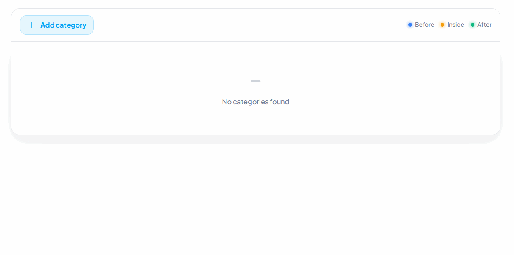
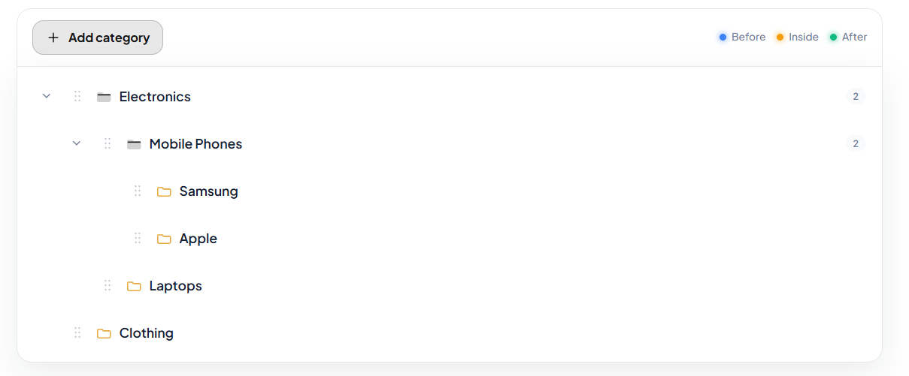
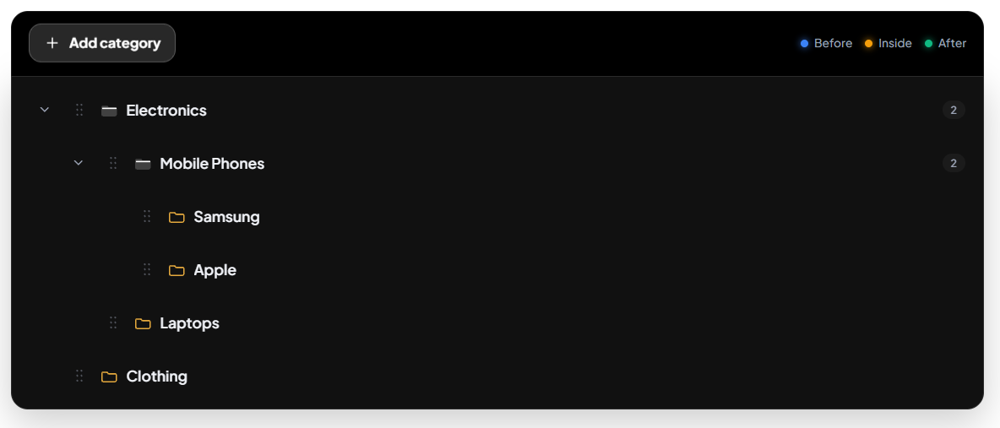
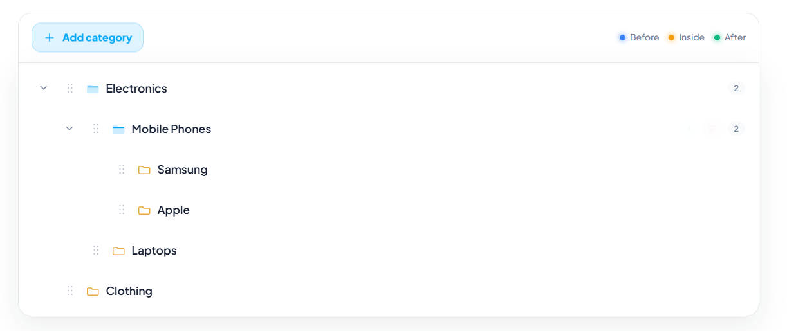
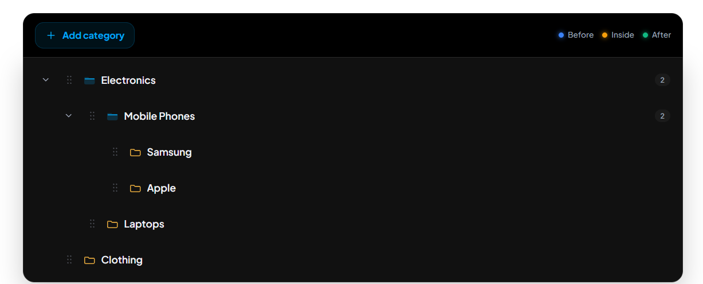
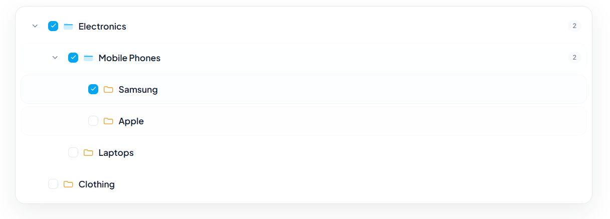

# react-tree-node

<div align="center">


</div>

A lightweight, standalone React tree view with selectable nodes, inline title editing, add/delete actions, and native drag-and-drop reordering. It has no runtime dependencies besides React and uses inline SVG icons.

<div align="center">
  
</div>

## Installation

```bash
npm install react-tree-node
```

The component imports its scoped stylesheet automatically. You can also import it explicitly when your bundler handles CSS entry points:

```tsx
import { TreeView } from "react-tree-node";
import "react-tree-node/styles.css";
```

## Quick start

```tsx
import { useState } from "react";
import { TreeView, type TreeNode } from "react-tree-node";

const initialItems: TreeNode[] = [
  {
    key: "products",
    title: "Products",
    children: [{ key: "books", title: "Books" }],
  },
];

export default function Example() {
  const [items, setItems] = useState(initialItems);

  return <TreeView items={items} onChange={setItems} inputName="categories" />;
}
```

Click an editable title to rename it. Press Enter or move focus away to save; press Escape to cancel. Drag rows before, inside, or after another row to reorder them.

## Preview

### Light & Dark Themes

<p align="center">
  
  
</p>

### Custom Colors

Use the `defaultColor` prop to customize the primary color across the entire component.

```tsx
export default function CustomColorExample() {
  return (
    <TreeView
      defaultItems={categories}
      defaultColor="#8b5cf6"
      theme="light"
    />
  );
}
```

<p align="center">
  
  
</p>

The `defaultColor` prop customizes the primary color throughout the tree view, including buttons, icons, active states, hover effects, and focus indicators. It works with both light and dark themes.

## Selectable mode

Set `type="selectable"` to enable checkbox-based node selection.

```tsx
<TreeView
  type="selectable"
  defaultItems={initialItems}
  inputName="selectedCategories"
  defaultChecked={[{ _id: "books", title: "Books" }]}
  onCheckedChange={(checked) => console.log(checked)}
/>
```

Selecting a child also includes its ancestors, matching the serialized `TreeItem[]` format used by the component.

<p align="center">
  
</p>

## Custom icons, labels, and drop colors

Every built-in icon can be replaced with a `ReactNode`. Omitted icons continue to use the package's inline SVG defaults.

```tsx
import { TreeView, type TreeViewIcons } from "react-tree-node";

const icons: TreeViewIcons = {
  folder: <span aria-hidden="true">📁</span>,
  openFolder: <span aria-hidden="true">📂</span>,
  add: <span aria-hidden="true">＋</span>,
  delete: <span aria-hidden="true">×</span>,
};

<TreeView
  defaultItems={initialItems}
  icons={icons}
  labels={{
    addCategory: "Create category",
    defaultCategoryTitle: "Untitled category",
    before: "Above",
  }}
  dropIndicatorColors={{
    before: "#0ea5e9",
    inside: "#f59e0b",
    after: "#22c55e",
  }}
  direction="ltr"
/>
```

`labels` is resolved as English defaults, then custom overrides. Individual labels can be overridden, and dynamic accessibility labels support the `{title}` placeholder, for example `addChild: "Add {title} below"`. The `direction` prop controls indentation, text alignment, icon placement, actions, and drop indicators for both LTR and RTL layouts.

## API

All `TreeView` props are optional. When `items` or `checkedItems` is provided, that value is controlled; otherwise the corresponding `defaultItems` or `defaultChecked` value initializes internal state.

| Prop | Type | Description |
| --- | --- | --- |
| `items` | `TreeNode[]` | Optional controlled tree data. If omitted, the component uses `defaultItems` and internal state. |
| `defaultItems` | `TreeNode[]` | Optional initial data for an uncontrolled tree. Defaults to `[]`. |
| `type` | `"editable" \| "selectable"` | Enables editing and drag actions or checkboxes. Defaults to `"editable"`. |
| `inputName` | `string` | Optional form field name. Adds a hidden field containing the tree or selected items as JSON when provided. |
| `onChange` | `(items: TreeNode[]) => void` | Optional callback called after tree data changes. |
| `defaultChecked` | `TreeItem[]` | Optional initial checked items in selectable mode. Defaults to `[]`. |
| `checkedItems` | `TreeItem[]` | Optional controlled checked items. If omitted, checked state is managed internally. |
| `onCheckedChange` | `(items: TreeItem[]) => void` | Optional callback called after selection changes. |
| `onTitleChange` | `(node, title) => void` | Optional callback called after an inline title edit. |
| `onDelete` | `(node) => void` | Optional callback called after a node is removed. |
| `height` | `number` | Optional maximum tree height in pixels. Applied as the shell's `max-height`; overflow is scrollable when needed. |
| `style` | `React.CSSProperties` | Optional inline styles applied to the tree shell. |
| `className` | `string` | Optional class name applied to the component root. |
| `defaultColor` | `string` | Optional CSS color used as the primary color in both themes, including the Add Category button, icons, active states, hover states, and focus indicators. |
| `theme` | `"light" \| "dark"` | Complete component theme. Defaults to `"light"`. |
| `direction` | `"ltr" \| "rtl"` | Layout direction. Defaults to `"ltr"`; use `"rtl"` for right-to-left layouts. |
| `icons` | `TreeViewIcons` | Optional ReactNode replacements for `expand`, `collapse`, `dragHandle`, `folder`, `openFolder`, `add`, `delete`, `check`, and `empty`. Defaults to inline SVG icons for omitted entries. |
| `labels` | `Partial<TreeViewLabels>` | Optional partial overrides for action text, tooltips, accessibility labels, default titles, drag guide labels, loading text, and empty-state text. Defaults to English labels. |
| `dropIndicatorColors` | `Partial<TreeViewDropIndicatorColors>` | Optional partial customization of `before`, `inside`, and `after` drop colors in rows and the guide legend. Defaults to blue `#3b82f6`, amber `#f59e0b`, and green `#10b981`. |
| `loading` | `boolean` | Shows the loading skeleton when `true`. Defaults to `false`. |
| `emptyMessage` | `ReactNode` | Optional replacement for the default `"No categories found"` message when there are no nodes. |
| `disabled` | `boolean` | Disables editing, selection, and drag actions when `true`. Defaults to `false`. |

The component uses the light theme by default. Use the `theme` prop to switch the complete component to dark mode. Theme styles are scoped to the tree view and do not alter host application styles:

```tsx
<TreeView items={initialItems} theme="dark" />
<TreeView items={initialItems} theme="light" />
<TreeView items={initialItems} defaultColor="#0f766e" />
```

## Development

```bash
npm install
npm run typecheck
npm run build
npm run pack:check
```